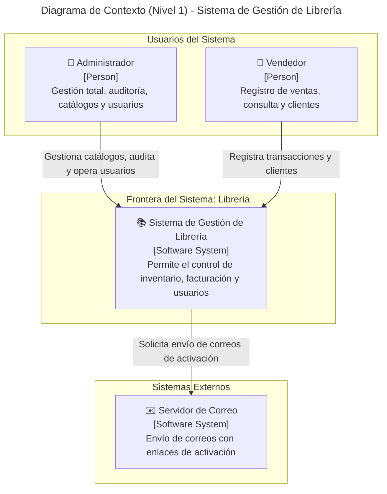
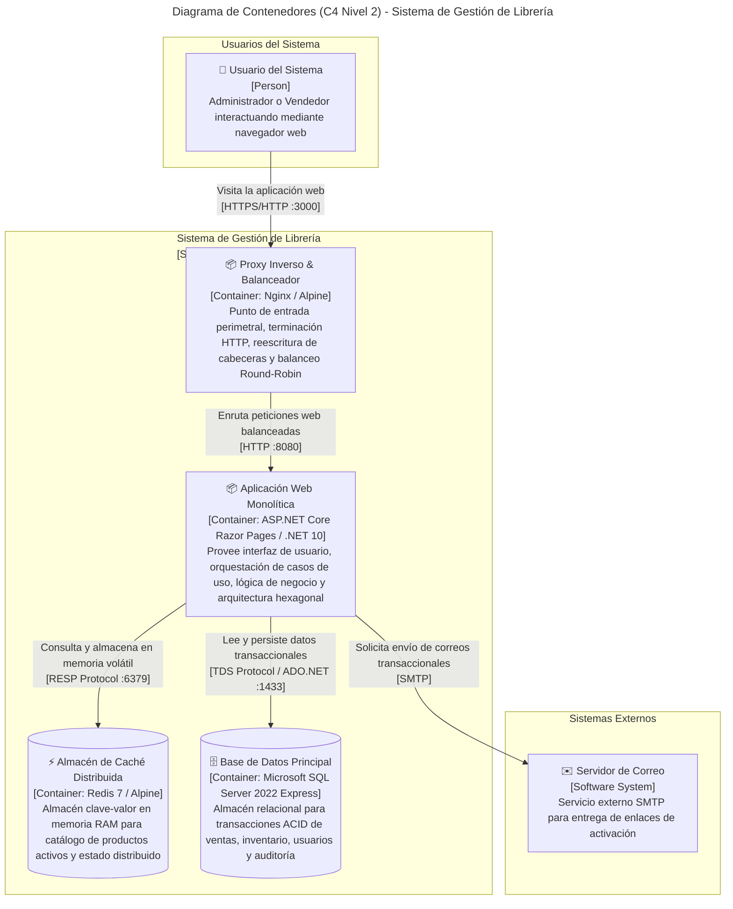
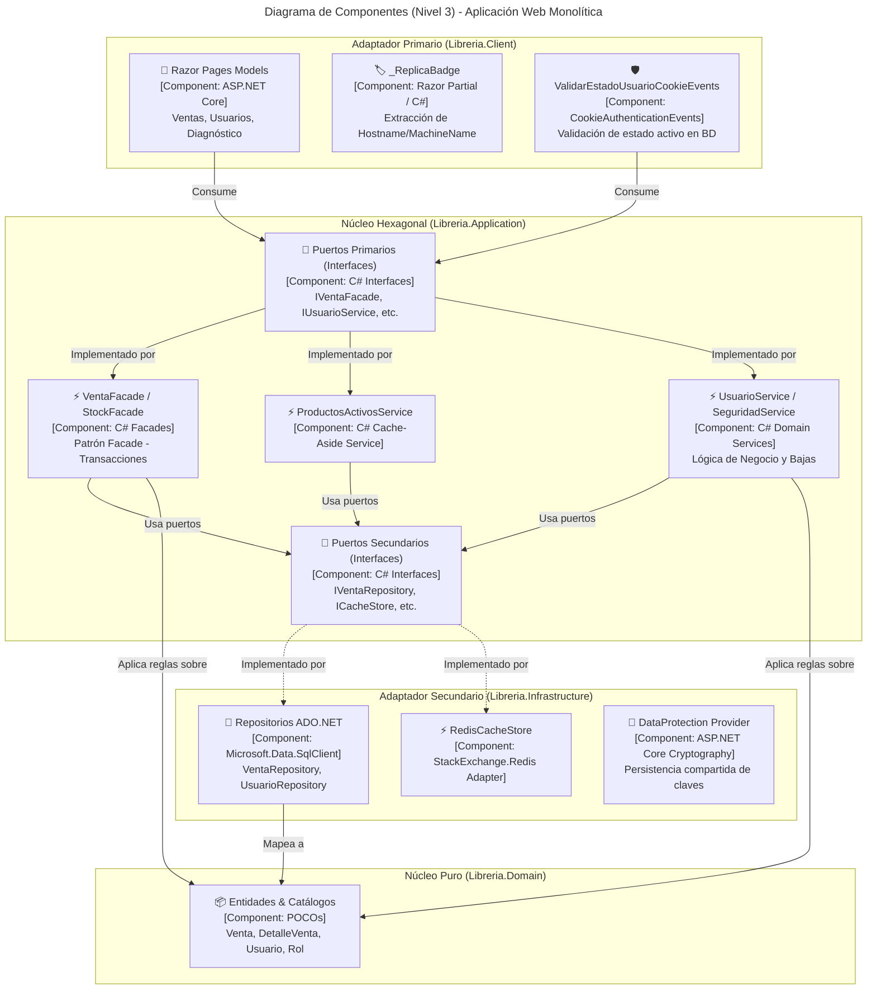
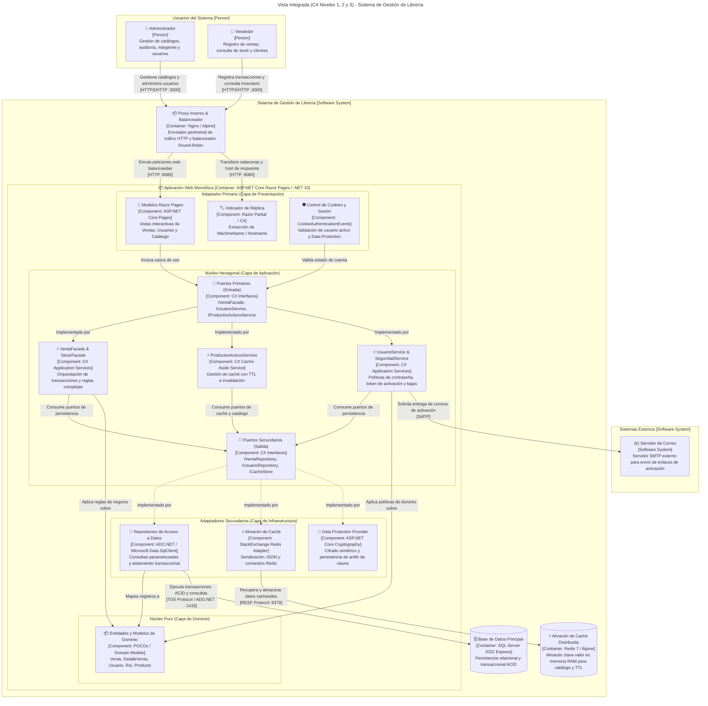
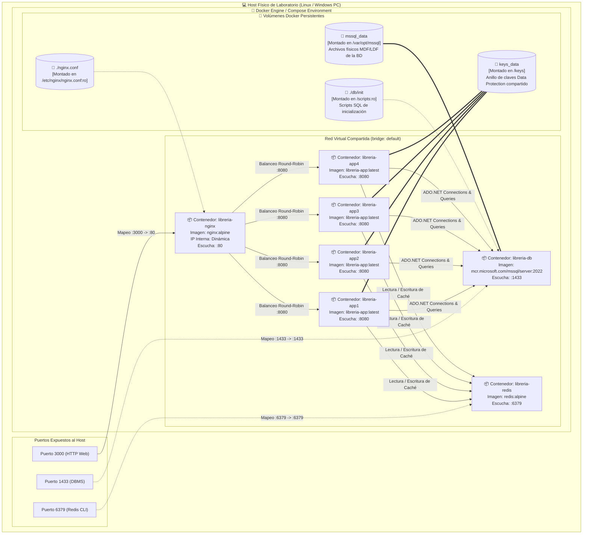

# INFORME TÉCNICO DE ARQUITECTURA DE SOFTWARE
## SEGUNDO ELEMENTO DE COMPETENCIA: ESCALAMIENTO HORIZONTAL DE UNA APLICACIÓN MONOLÍTICA
### PROYECTO: SISTEMA DE GESTIÓN DE INVENTARIO Y VENTAS — LIBRERÍA

---

## 1. INTRODUCCIÓN Y OBJETIVOS

### 1.1. Introducción
El desarrollo moderno de software empresarial exige que los sistemas no solo satisfagan requerimientos funcionales de negocio, sino que también garanticen atributos de calidad esenciales como disponibilidad continua, tolerancia a fallos, rendimiento bajo alta concurrencia y escalabilidad operativa.

En la primera etapa del proyecto, construimos un sistema monolítico modular organizado por responsabilidad técnica bajo los principios de la Arquitectura Hexagonal (Puertos y Adaptadores), persistencia relacional con ADO.NET puro y una interfaz web interactiva sobre ASP.NET Core Razor Pages. Si bien este diseño garantizó un estricto desacoplamiento y apego a los principios SOLID, su ejecución dependía de un único proceso de servidor en memoria. Esta dependencia introducía un punto único de falla (*Single Point of Failure*, SPOF) y limitaba la capacidad de procesamiento concurrente a los recursos físicos de una sola instancia de cómputo.

El presente informe documenta la auditoría de ingeniería y evolución técnica aplicada en este segundo sprint: la transformación del monolito local en un clúster contenedorizado de alta disponibilidad distribuido con Docker Compose, balanceado mediante Nginx como proxy inverso, acelerado con Redis bajo el patrón Cache-Aside y blindado mediante la sincronización descentralizada de estado criptográfico con ASP.NET Core Data Protection.

### 1.2. Objetivos

#### Objetivo General
Evolucionar la arquitectura monolítica modular existente hacia una solución escalada horizontalmente y contenerizada, garantizando alta disponibilidad, distribución equitativa de carga entre múltiples réplicas activas, sincronización transparente de sesiones y optimización de lectura de datos mediante caché distribuida, preservando íntegramente las reglas de negocio, transacciones ACID y patrones de diseño previamente implementados.

#### Objetivos Específicos
1. **Contenerizar y orquestar el clúster de ejecución:** Diseñar imágenes Docker reproducibles y orquestar mediante Docker Compose un entorno integrado por la base de datos relacional, el motor de caché distribuida, el proxy inverso y cuatro réplicas simultáneas e independientes del monolito web.
2. **Implementar balanceo de carga y tolerancia a fallos:** Configurar Nginx bajo una política de balanceo Round-Robin con detección activa y pasiva de nodos caídos (*health checking* agresivo), garantizando la continuidad inmediata del servicio y exponiendo de manera verificable el identificador del nodo que resuelve cada petición.
3. **Externalizar y sincronizar el estado de sesión y seguridad:** Desacoplar la criptografía de autenticación mediante un anillo compartido de claves criptográficas persistidas a través de un volumen común en ASP.NET Core Data Protection, permitiendo el consumo transparente de Cookies y Claims entre réplicas heterogéneas.
4. **Implementar el patrón Cache-Aside con Redis:** Diseñar un adaptador secundario desacoplado para almacenar en memoria el catálogo de productos activos de alta concurrencia, estableciendo políticas de expiración temporal (TTL) e invalidación atómica ante mutaciones de datos.
5. **Construir el módulo de administración y seguridad de usuarios:** Desarrollar sobre ADO.NET puro un subsistema completo de gestión de usuarios que garantice generación determinista de nombres de usuario únicos, flujos de activación asíncrona mediante tokens seguros por correo electrónico, baja lógica transaccional serializable e inmunidad ante la exposición de credenciales en consultas de lectura.

---

## 2. DESCRIPCIÓN DEL SISTEMA Y EVOLUCIÓN

### 2.1. Descripción del Sistema y Proceso Principal
El sistema resuelve de manera integral la administración operativa de una librería comercial. Su proceso principal radica en el **Flujo Transaccional de Ventas**, el cual involucra operaciones de alta criticidad:
* Consulta dinámica y selección reactiva de clientes y productos.
* Validación estricta de existencias en almacén.
* Registro atómico multilínea en tablas relacionales de cabecera y detalle (`Venta` y `DetalleVenta`).
* Deducción y restauración matemática de existencias físicas mediante fachadas de inventario.
* Auditoría formal de transacciones (usuario creador, usuario anulador, marcas temporales).
* Emisión automática del comprobante de venta fiscal.

### 2.2. Evolución Arquitectónica hacia el Segundo Entregable
Durante el primer entregable, la aplicación operaba bajo un esquema monolítico en un único entorno de ejecución local (`localhost:5000`), donde el ciclo de vida del servidor web concentraba la gestión de memoria, la emisión de cookies y las conexiones a base de datos.

La evolución implementada transformó radicalmente el modelo operacional sin fracturar el código de dominio ni la estructura de proyectos:

```
+-----------------------------------------------------------------------------------+
| ANTES: Monolito Local                                                             |
| [Navegador] ---> [Instancia Única Kestrel] ---> [Base de Datos Relacional]        |
|                  * Claves criptográficas en RAM local                             |
|                  * Consultas repetitivas sin caché                                |
|                  * Si el proceso cae, el sistema colapsa                          |
+-----------------------------------------------------------------------------------+
                                          |
                                          v
+-----------------------------------------------------------------------------------+
| AHORA: Monolito Escalado Horizontalmente                                          |
|                                                                                   |
|                  +------------------ [ Nginx Proxy ] <--- [Navegador Web]         |
|                  |                     (:3000)                                    |
|                  v                                                                |
|       +--------------------+--------------------+--------------------+            |
|       |                    |                    |                    |            |
|       v                    v                    v                    v            |
|  [Réplica App 1]      [Réplica App 2]      [Réplica App 3]      [Réplica App 4]   |
|       |                    |                    |                    |            |
|       +----------+---------+----------+---------+----------+---------+            |
|                  |                    |                    |                      |
|                  v                    v                    v                      |
|         [Volumen Compartido]   [Cluster Redis]   [SQL Server 2022]                |
|           (/keys DataProt)       (Caché TTL)     (Persistencia ACID)              |
+-----------------------------------------------------------------------------------+
```

Esta transición convierte al sistema en una plataforma resiliente capaz de soportar la pérdida abrupta de nodos de procesamiento sin degradación de cara al usuario final.

---

## 3. ARQUITECTURA EXISTENTE VS. ESCALADA HORIZONTALMENTE: EL RETO DEL ESTADO

### 3.1. Cuadro Comparativo Arquitectónico

| Dimensión Arquitectónica | Arquitectura Anterior (Monolito Aislado) | Arquitectura Escalada (Monolito Distribuido) |
| :--- | :--- | :--- |
| **Topología de Procesos** | Proceso único en ejecución local. | Cuatro procesos independientes en contenedores Docker. |
| **Punto de Entrada** | Acceso directo al puerto de la aplicación. | Proxy inverso Nginx con balanceo Round-Robin. |
| **Tolerancia a Fallos** | Nula. La detención del proceso causa indisponibilidad total. | Alta. Si un nodo falla, Nginx redirige el tráfico en milisegundos. |
| **Gestión de Sesiones** | Anillo criptográfico efímero en memoria de la instancia. | Anillo de claves descentralizado mediante volumen compartido (`keys_data`). |
| **Rendimiento de Lectura** | Cada petición impacta directamente al motor relacional. | Patrón Cache-Aside sobre Redis con TTL e invalidación dirigida. |
| **Persistencia de Identidad** | Conexiones locales no segregadas. | Red virtual aislada bridge con variables de entorno protegidas. |

### 3.2. El Reto Técnico de la Externalización del Estado
El principal obstáculo técnico al escalar horizontalmente aplicaciones basadas en cookies y claims consiste en la **fragmentación del estado criptográfico**.

En una configuración predeterminada de ASP.NET Core, el proveedor de protección de datos (*Data Protection API*) genera una clave simétrica única almacenada en la memoria volátil o en el perfil de usuario del host local. Bajo un esquema balanceado:
1. Una petición inicial de autenticación aterriza en la **Réplica 1**, la cual cifra la cookie de autenticación con su clave privada local.
2. La siguiente petición de navegación es dirigida por Nginx hacia la **Réplica 2**.
3. Al carecer de la clave privada que originó el cifrado, la Réplica 2 es incapaz de desencriptar el payload de la cookie, interpreta la sesión como corrupta, expulsa al usuario del sistema y lo redirige compulsivamente al formulario de inicio de sesión (`/Cuenta/Login`).

Para resolver este desafío y garantizar nodos completamente desprovistos de estado (*stateless*), desacoplamos el ciclo de vida de las claves del ciclo de vida de los contenedores. Configuramos un volumen Docker compartido (`keys_data`) montado en la ruta `/keys` de cada réplica, forzando a todas las instancias a converger en un mismo almacén criptográfico centralizado y a identificarse bajo el mismo nombre de aplicación unificado (`LibreriaCompartida`).

---

## 4. DIAGRAMAS DE ARQUITECTURA CON C4 MODEL (NIVELES 1, 2 Y 3)

El modelado formal de la arquitectura se estructuró siguiendo el estándar **C4 Model**, permitiendo descomponer progresivamente el sistema desde el contexto operacional hasta la interacción interna de sus módulos de software.

### 4.1. Nivel 1: Diagrama de Contexto del Sistema
El diagrama de contexto establece los límites del sistema, identificando los actores humanos primarios y los sistemas externos con los que colabora:



**Explicación del Nivel 1:**
* **Administrador:** Usuario autenticado con privilegios completos para gestionar el catálogo de inventario, dar de alta y baja usuarios, auditar márgenes de ganancia y anular transacciones.
* **Vendedor:** Usuario de mostrador enfocado exclusivamente en la captura rápida de ventas, consulta de existencias y alta rápida de clientes.
* **Sistema de Gestión de Librería:** Núcleo de software responsable de aplicar las políticas de negocio, transacciones ACID y caché distribuida.
* **Servidor de Correo:** Sistema externo de transporte de mensajería (SMTP) utilizado para notificar a nuevos usuarios su enlace de activación de cuenta.

---

### 4.2. Nivel 2: Diagrama de Contenedores
Ilustra la arquitectura lógica del sistema descomponiéndolo en sus aplicaciones y almacenes de datos autónomos (contenedores en el estándar C4), los protocolos de comunicación utilizados y las responsabilidades asignadas:



**Explicación del Nivel 2 (Diagrama de Contenedores):**
En el estándar **C4 Model**, un **Contenedor** representa un subsistema ejecutable o almacén de datos autónomo (unidad lógica de software), distinguiéndose conceptualmente de un contenedor de virtualización física (Docker). El diagrama refleja la descomposición lógica del sistema y las responsabilidades arquitectónicas asignadas:

* **Proxy Inverso y Balanceador (`Container: Nginx / Alpine`):** Actúa como único punto de entrada perimetral para el tráfico externo. Centraliza la recepción de solicitudes HTTP/HTTPS en el puerto `:3000`, efectúa la terminación de transporte, propaga las cabeceras proxy (`X-Forwarded-For`, `X-Forwarded-Proto`) y distribuye uniformemente la carga hacia la aplicación web mediante el algoritmo Round-Robin.
* **Aplicación Web Monolítica (`Container: ASP.NET Core Razor Pages / .NET 10`):** Núcleo ejecutable del sistema estructurado bajo Arquitectura Hexagonal. Gestiona la presentación web interactiva, autenticación por cookies mediante Data Protection, orquestación de casos de uso (Ventas, Inventario, Usuarios) y validaciones de dominio sin depender directamente de implementaciones de infraestructura.
* **Almacén de Caché Distribuida (`Container: Redis 7 / Alpine`):** Almacenamiento clave-valor en memoria de alta velocidad operando bajo el protocolo binario RESP en el puerto `:6379`. Implementa el patrón Cache-Aside para el catálogo de productos activos (reduciendo drásticamente la latencia de lectura en transacciones de mostrador) y soporta la coherencia de estado distribuido.
* **Base de Datos Principal (`Container: Microsoft SQL Server 2022 Express`):** Almacén relacional principal del sistema en el puerto `:1433`. Garantiza la durabilidad, consistencia y atomicidad (propiedades ACID) de las operaciones transaccionales mediante el protocolo TDS, comunicándose exclusivamente con la capa de infraestructura a través de ADO.NET puro sin sobrecargas de ORM.
* **Servidor de Correo (`Software System: Externo`):** Sistema externo que recibe comandos SMTP para la entrega de correos de notificación y enlaces de activación de credenciales.

---

### 4.3. Nivel 3: Diagrama de Componentes (Interno de una Réplica)
Detalla la estructuración interna de código dentro de cualquiera de las réplicas activas, evidenciando el desacoplamiento estricto de la Arquitectura Hexagonal:



**Explicación del Nivel 3:**
* **`Libreria.Client` (Adaptador Primario):** Gestiona la presentación web. Consume exclusivamente puertos primarios mediante Inyección de Dependencias sin instanciar clases de base de datos ni conocer a Redis.
* **`Libreria.Application` (Lógica de Aplicación):** Contiene la inteligencia del negocio. Las fachadas y servicios coordinan los flujos transaccionales e interactúan hacia el exterior únicamente mediante contratos (puertos secundarios).
* **`Libreria.Infrastructure` (Adaptador Secundario):** Implementa el acceso a datos crudo mediante ADO.NET, la serialización hacia Redis y el cifrado de datos.
* **`Libreria.Domain` (Dominio Puro):** Modelo de objetos sin dependencias de infraestructura ni frameworks.

---

## 5. VISTA INTEGRADA (NIVELES 1, 2 Y 3: DIAGRAMA COMBINADO C4)

A continuación, se presenta la vista arquitectónica unificada que correlaciona de manera continua a los actores, la frontera del sistema de software, los contenedores perimetrales y de persistencia, y el zoom detallado a los componentes de la Arquitectura Hexagonal dentro del contenedor web:



**Explicación de la Vista Integrada (Correlación Niveles 1, 2 y 3):**
La vista integrada unifica los tres primeros niveles del Modelo C4, proporcionando una trazabilidad integral y sin fisuras del ciclo de vida de una petición, desde la interacción humana en el cliente web hasta los motores de almacenamiento relacional y en memoria:

1. **Interacción del Usuario al Perímetro (Nivel 1 ➔ Nivel 2):**
   Los actores humanos (**Administrador** y **Vendedor**) efectúan peticiones HTTP/HTTPS desde sus exploradores hacia la dirección IP del servidor en el puerto público `:3000`. Estas solicitudes son interceptadas por el contenedor perimetral **Proxy Inverso (Nginx)**, que actúa como escudo protector, realiza la terminación de transporte, sanitiza las cabeceras (`X-Forwarded-For`, `X-Forwarded-Proto`) y balancea la carga de forma equitativa mediante Round-Robin.
2. **Recepción en el Contenedor Web y Presentación (Nivel 2 ➔ Nivel 3):**
   Nginx reenvía la solicitud por el puerto interno `:8080` hacia el contenedor **Aplicación Web Monolítica (ASP.NET Core)**. Dentro del contenedor, la petición ingresa por el **Adaptador Primario** en la capa de presentación (`RazorPages`), ejecutando el ciclo de vida del *PageModel* correspondiente (`OnGetAsync` o `OnPostAsync`). En paralelo, el componente transversal `ReplicaBadge` extrae las propiedades del entorno (`Environment.MachineName`) para estampar la identidad de la réplica en la vista, y `AuthEvents` (`CookieAuthenticationEvents`) valida contra el anillo de claves compartido de `DataProtection` que la sesión no haya sido revocada ni el usuario dado de baja.
3. **Invocación a través de Puertos Primarios (Nivel 3 - Capa de Aplicación):**
   Siguiendo los principios de la Arquitectura Hexagonal y la Inversión de Dependencias (IoC), la capa de presentación desconoce por completo la existencia de motores SQL o servidores Redis. Los modelos Razor invocan exclusivamente **Puertos Primarios** tipados mediante interfaces (`IVentaFacade`, `IUsuarioService`, `IProductosActivosService`). El **Núcleo Hexagonal** asume el control:
   * `VentaFacade`: Orquesta la apertura transaccional, cálculo de totales, descuento de existencias y emisión de comprobantes.
   * `ProductosActivosService`: Implementa la estrategia de *Cache-Aside* con caducidad e invalidación tras operaciones de venta.
   * `UsuarioService`: Coordina la generación de nombres de usuario únicos normalizados, validación de contraseñas bajo directivas seguras y baja lógica.
4. **Desacoplamiento hacia Adaptadores Secundarios (Nivel 3 - Capa de Infraestructura):**
   Los servicios de aplicación requieren comunicarse con el exterior mediante **Puertos Secundarios** (`IVentaRepository`, `IUsuarioRepository`, `ICacheStore`). Estos puertos son satisfechos por componentes de la capa de infraestructura:
   * `SqlRepos`: Implementa acceso a datos mediante ADO.NET crudo (`Microsoft.Data.SqlClient`), mapeando directamente hacia las entidades de dominio (`Entities`) sin exponer credenciales ni depender de abstracciones pesadas.
   * `RedisStore`: Implementa la comunicación con la memoria volátil a través del cliente `StackExchange.Redis`, serializando y deserializando modelos JSON livianos.
   * `DataProtectionCfg`: Configura el proveedor criptográfico simétrico para la firma y cifrado de las cookies de autenticación.
5. **Persistencia Final y Sistemas Externos (Nivel 3 ➔ Nivel 2 y Nivel 1):**
   * **Base de Datos Principal (`Database`):** Los repositorios SQL abren conexiones físicas mediante el protocolo TDS (`:1433`) hacia Microsoft SQL Server 2022, garantizando aislamiento transaccional y atomicidad en cada inserción o actualización.
   * **Almacén de Caché Distribuida (`RedisServer`):** Ante un *Cache MISS* en la consulta de inventario, `RedisStore` almacena la colección serializada con expiración TTL vía protocolo RESP (`:6379`); ante un *Cache HIT*, retorna los datos en sub-milisegundos evitando sobrecargar el motor SQL.
   * **Servidor de Correo Externo (`ServidorCorreo`):** Al concretar el alta de un usuario, `UsuarioService` interactúa con el servidor de correo corporativo mediante el protocolo SMTP para entregar el enlace con el token de activación criptográfica.

---

## 6. DIAGRAMA DE DESPLIEGUE (DEPLOYMENT DIAGRAM)

El siguiente diagrama formaliza el mapeo físico entre el hardware anfitrión (*Host OS*), el motor de ejecución de Docker, la red virtual compartida tipo bridge, los puntos de montaje de volúmenes persistentes y el aislamiento de puertos:



**Explicación del Diagrama de Despliegue:**
El diagrama de despliegue formaliza el mapeo físico y la infraestructura de virtualización sobre el host de laboratorio:
* **Host Físico y Puertos Expuestos:** Se mapean tres puntos de entrada hacia el sistema anfitrión: puerto `:3000` redirigido al puerto `:80` de `libreria-nginx` para acceso web, puerto `:1433` hacia `libreria-db` para administración por herramientas SQL externas, y puerto `:6379` hacia `libreria-redis` para inspección con Redis CLI.
* **Red Virtual Docker (Bridge):** Todos los contenedores convergen en una red bridge común, permitiendo la resolución de nombres DNS interna de Docker (`app1`, `app2`, `app3`, `app4`, `db`, `redis`, `nginx`) sin exponer los puertos internos `:8080` de las aplicaciones al exterior.
* **Clúster de Réplicas Web (`libreria-app1` a `libreria-app4`):** Cuatro instancias idénticas ejecutando la imagen compilada sobre ASP.NET Core Razor Pages (.NET 10). Cada réplica consume independientemente los servicios de Redis y SQL Server y responde peticiones HTTP balanceadas por Nginx.
* **Volúmenes Persistentes y Montajes:**
  * `keys_data`: Volumen compartido montado en `/keys` de las cuatro réplicas para descentralizar el anillo criptográfico de Data Protection.
  * `mssql_data`: Volumen administrado montado en `/var/opt/mssql` para asegurar la durabilidad física de las bases de datos (archivos `.mdf` y `.ldf`).
  * `./db/init` y `./nginx.conf`: Bind mounts de sólo lectura (`:ro`) para aprovisionamiento declarativo del esquema y de las reglas de balanceo.

---

## 7. PATRONES ARQUITECTÓNICOS Y DE DISEÑO IMPLEMENTADOS

### 7.1. Inversión de Dependencias (IoC / Dependency Injection)
El principio de Inversión de Dependencias (la **D** de SOLID) se cumple estrictamente mediante el contenedor nativo de ASP.NET Core configurado en `Program.cs`. Las capas superiores jamás instancian implementaciones concretas; dependen únicamente de interfaces contractualmente fijadas en la capa de Aplicación.

### 7.2. Patrón Repository (Sobre ADO.NET Puro)
Para desacoplar el motor de base de datos de la lógica de negocio, se diseñaron repositorios tipados (`UsuarioRepository`, `VentaRepository`, `ProductoRepository`) bajo contratos de puertos secundarios (`IUsuarioRepository`, `IVentaRepository`, `IProductoRepository`). Esto asegura que ninguna sentencia SQL o dependencia de `Microsoft.Data.SqlClient` se filtre hacia el dominio.

### 7.3. Patrón Facade (`VentaFacade` y `StockFacade`)
El proceso de ventas representa un flujo de alta complejidad que exige coordinar múltiples servicios heterogéneos: validación de cliente, comprobación de catálogo, apertura de conexión física, inicio de transacción ACID, inserción en cabecera y detalle, descuento de stock y cálculo de márgenes. 
El patrón **Facade** encapsula toda esta orquestación técnica compleja detrás de un método simple y cohesivo (`RegistrarVentaAsync`), entregando a la UI un punto de contacto único, claro y desacoplado:

```csharp
public async Task<int> RegistrarVentaAsync(Venta venta, List<DetalleVenta> detalles)
{
    await using var connection = _connectionFactory.CreateConnection();
    await connection.OpenAsync();
    await using var transaction = await connection.BeginTransactionAsync();

    var ventaId = await _ventaRepository.InsertarAsync(venta, connection, transaction);
    await _stockFacade.DescontarStockAsync(detalles, connection, transaction);
    await transaction.CommitAsync();

    await _productosService.InvalidarAsync();
    return ventaId;
}
```
Nota: Para ver la implementación completa y el contexto de esta clase, se puede revisar el repositorio en el archivo VentaFacade.cs.

### 7.4. Cumplimiento de Principios SOLID y Clean Code
* **S (Single Responsibility):** Se separó la lógica de validación de contraseñas (`PasswordPolicyValidator`), generación de identificadores (`GeneradorNombreUsuario`), emisión de correos (`SmtpEmailSender`) y persistencia de seguridad (`UsuarioSeguridadService`).
* **O (Open/Closed):** La arquitectura de repositorios basada en fábricas abstractas (`CrudRepositoryFactory<T>`) permite extender nuevas entidades de catálogo sin modificar el código base.
* **L (Liskov Substitution):** Todas las clases derivadas de repositorios cumplen íntegramente los contratos definidos en `ICrudRepository<T>` sin alterar precondiciones ni lanzar excepciones de falta de implementación.
* **I (Interface Segregation):** Se segregaron puertos extensos en contratos específicos: `IConsultaVentaService` para búsquedas, `IComprobanteVentaService` para lectura fiscal y `IVentaFacade` para mutaciones transaccionales.
* **D (Dependency Inversion):** Los servicios de aplicación solo reciben abstracciones en sus constructores, permitiendo pruebas unitarias con fakes e inversión del flujo de dependencias.

---

## 8. DECISIONES TÉCNICAS Y EVIDENCIAS DE CÓDIGO

### 8.1. Orquestación del Clúster (`docker-compose.yml`)
**Decisión Técnica:** Se optó por levantar el clúster con cuatro réplicas de aplicación (superando el umbral de tres exigido), configurando dependencias de salud estrictas (`condition: service_healthy`) para asegurar que los contenedores web inicien únicamente tras la disponibilidad comprobada de Redis y SQL Server:

```yaml
services:
  app1:
    image: libreria-app:latest
    container_name: libreria-app1
    volumes:
      - keys_data:/keys
    depends_on:
      db: { condition: service_healthy }
      redis: { condition: service_healthy }

  nginx:
    image: nginx:alpine
    container_name: libreria-nginx
    ports:
      - "3000:80"
    volumes:
      - ./nginx.conf:/etc/nginx/nginx.conf:ro
    depends_on: [app1, app2, app3, app4]
```
Nota: Para ver la implementación completa y el contexto de esta clase, se puede revisar el repositorio en el archivo docker-compose.yml.

### 8.2. Balanceo de Carga y Conmutación por Falla (`nginx.conf`)
**Decisión Técnica:** Se configuró un bloque `upstream` con algoritmo Round-Robin. Para garantizar la continuidad de servicio ante la caída deliberada de un nodo (`docker stop`), se fijaron umbrales de detección agresivos (`max_fails=2`, `fail_timeout=5s`, `proxy_connect_timeout 3s`) combinados con la directiva `proxy_next_upstream`, la cual desvía la petición en vuelo a un nodo sano sin arrojar un error HTTP 502 al usuario. Se añadió además el encabezado de diagnóstico `X-Served-By`:

```nginx
upstream backend {
    server app1:8080 max_fails=2 fail_timeout=5s;
    server app2:8080 max_fails=2 fail_timeout=5s;
    server app3:8080 max_fails=2 fail_timeout=5s;
    server app4:8080 max_fails=2 fail_timeout=5s;
}

server {
    listen 80;
    location / {
        proxy_pass http://backend;
        proxy_set_header Host $http_host;
        proxy_set_header X-Forwarded-For $proxy_add_x_forwarded_for;
        add_header X-Served-By $upstream_addr always;
        proxy_connect_timeout 3s;
        proxy_next_upstream error timeout http_500 http_502 http_503 http_504;
    }
}
```
Nota: Para ver la implementación completa y el contexto de esta clase, se puede revisar el repositorio en el archivo nginx.conf.

### 8.3. Visualización del Identificador Real de Réplica (`_ReplicaBadge.cshtml`)
**Decisión Técnica:** Para transparentar qué nodo del clúster resolvió la transacción y validar el balanceo en la interfaz visual, se implementó una vista parcial que renderiza la propiedad nativa del sistema operativo `@Environment.MachineName`. En entornos contenerizados bajo Linux, esta propiedad devuelve dinámicamente el *Container Hostname*, demostrando que no se trata de un valor estático simulado:

```cshtml
<div class="replica-badge">
    Servidor que atendió la solicitud: 
    <span class="badge-hostname">@Environment.MachineName</span>
</div>
```
Nota: Para ver la implementación completa y el contexto de esta clase, se puede revisar el repositorio en el archivo _ReplicaBadge.cshtml.

### 8.4. Sincronización de Claves Criptográficas en `Program.cs`
**Decisión Técnica:** Se invocó `AddDataProtection` indicando el almacenamiento de claves en la ruta `/keys` (montada sobre el volumen Docker persistente `keys_data`) y asignando un nombre de aplicación homogéneo (`LibreriaCompartida`):

```csharp
builder.Services.AddDataProtection()
    .PersistKeysToFileSystem(new DirectoryInfo(@"/keys"))
    .SetApplicationName("LibreriaCompartida");
```
Nota: Para ver la implementación completa y el contexto de esta clase, se puede revisar el repositorio en el archivo Program.cs.

### 8.5. Caché Distribuida con Redis y Patrón Cache-Aside
**Decisión Técnica:** Se seleccionó el listado de productos activos como la consulta de mayor frecuencia de lectura. Se implementó `ProductosActivosService` gestionando las condiciones de HIT, MISS, almacenamiento con expiración de 5 minutos e invalidación atómica ante modificaciones.

#### Recuperación Cache-Aside (HIT vs. MISS con TTL)
```csharp
// 1. Intento de lectura desde Redis (Cache HIT)
var productosCacheados = await _cacheStore.ObtenerAsync<List<Producto>>(CacheKeys.ProductosActivos);
if (productosCacheados is not null)
{
    await RegistrarResultadoAsync("HIT", "Redis", await ObtenerTiempoVidaSeguroAsync(), cronometro.Elapsed.TotalMilliseconds);
    return productosCacheados;
}

// 2. Consulta a Base de Datos en caso de ausencia (Cache MISS) y guardado con TTL
var productos = await repository.ObtenerActivasAsync();
await _cacheStore.GuardarAsync(CacheKeys.ProductosActivos, productos, _expiracionCache);
await RegistrarResultadoAsync("MISS", "SQL", await ObtenerTiempoVidaSeguroAsync(), cronometro.Elapsed.TotalMilliseconds);
return productos;
```
Nota: Para ver la implementación completa y el contexto de esta clase, se puede revisar el repositorio en el archivo ProductosActivosService.cs.

#### Invalidación Atómica de Caché
```csharp
public async Task InvalidarAsync()
{
    // Expulsa la clave del clúster Redis obligando a refrescar desde SQL Server
    await _cacheStore.EliminarAsync(CacheKeys.ProductosActivos);
    _logger.LogInformation("Caché invalidada Clave={CacheKey} Réplica={Replica}",
        CacheKeys.ProductosActivos, Environment.MachineName);
}
```
Nota: Para ver la implementación completa y el contexto de esta clase, se puede revisar el repositorio en el archivo ProductosActivosService.cs.

---

## 9. MÓDULO DE USUARIOS: ADMINISTRACIÓN, SEGURIDAD Y ADO.NET

### 9.1. Consulta SELECT Segura (Sin Exposición de Credenciales)
**Decisión de Seguridad:** Para evitar brechas de seguridad o fugas de información sensible en memoria, la sentencia SQL en ADO.NET dentro de `UsuarioRepository.cs` proyecta estrictamente las columnas públicas y de auditoría, prescindiendo por completo de `PasswordHash` o `TokenActivacionHash`:

```csharp
command.CommandText = @"
    SELECT u.PublicId, u.NombreCompleto, u.NombreUsuario, u.Correo,
           r.Nombre AS Rol, u.Estado, u.FechaCreacion,
           creador.NombreCompleto AS CreadoPor
    FROM dbo.Usuario u
    INNER JOIN dbo.Rol r ON r.RolId = u.RolId
    LEFT JOIN dbo.Usuario creador ON creador.UsuarioId = u.UsuarioCreacionId
    WHERE (@Estado IS NULL OR u.Estado = @Estado)
    ORDER BY u.FechaCreacion DESC";

AgregarParametro(command, "@Estado", estado is null ? DBNull.Value : estado, DbType.String, 20);
await using var reader = await command.ExecuteReaderAsync();
// Proyección limpia directa al DTO sin consultar PasswordHash ni TokenActivacionHash
```
Nota: Para ver la implementación completa y el contexto de esta clase, se puede revisar el repositorio en el archivo UsuarioRepository.cs.

### 9.2. Generación Determinista de Nombre de Usuario Único
**Regla de Negocio:** El sistema compone el nombre de usuario normalizando el texto (remoción de acentos mediante descomposición Unicode `FormD`), extrayendo la inicial del primer nombre y concatenando el apellido completo. Si el nombre base colisiona en base de datos, incrementa un sufijo numérico secuencial a partir del número 2:

```csharp
public async Task<string> GenerarAsync(string nombre, string apellido)
{
    var nombreBase = $"{Normalizar(nombre)[0]}{Normalizar(apellido)}";
    if (!await _usuarioRepository.ExisteNombreUsuarioAsync(nombreBase))
        return nombreBase;

    var numero = 2;
    while (await _usuarioRepository.ExisteNombreUsuarioAsync($"{nombreBase}{numero}"))
    {
        numero++;
    }
    return $"{nombreBase}{numero}";
}
```
Nota: Para ver la implementación completa y el contexto de esta clase, se puede revisar el repositorio en el archivo GeneradorNombreUsuario.cs.

### 9.3. Inserción Transaccional y Enlace de Activación por Correo
**Flujo Criptográfico Seguro:** El nuevo usuario se crea en estado inactivo (`Pendiente`) con `PasswordHash` vacío. Se genera un token criptográfico en Base64 URL-safe; **únicamente el hash SHA-256 del token es persistido en base de datos**, garantizando que si la base de datos sufriera una filtración, los enlaces en tránsito no puedan ser reconstruidos. El token original viaja en el cuerpo del correo mediante SMTP:

```csharp
// Token en texto plano para el correo; solo el hash SHA-256 se persiste en BD
var token = TokenActivacionService.GenerarToken();
var tokenHash = TokenActivacionService.CalcularHash(token);
usuario.TokenActivacionHash = tokenHash;
usuario.TokenActivacionExpiracion = DateTime.UtcNow.AddHours(24);

await using var connection = _connectionFactory.CreateConnection();
await using var transaction = await connection.BeginTransactionAsync();
await _usuarioRepository.InsertarAsync(usuario, connection, transaction);

var enlace = ConstruirEnlaceActivacion(tokenHash, token);
await _emailSender.EnviarAsync(usuario.Correo, "Activa tu cuenta", ConstruirCorreo(usuario.Nombre, enlace));

await transaction.CommitAsync();
```
Nota: Para ver la implementación completa y el contexto de esta clase, se puede revisar el repositorio en el archivo UsuarioService.cs.

### 9.4. Baja Lógica y Bloqueo Inmediato de Sesión

#### Reglas de Negocio en `UsuarioSeguridadService.cs`
Para evitar condiciones de carrera, la baja lógica se ejecuta bajo un nivel de aislamiento `IsolationLevel.Serializable`. Se prohíbe explícitamente que un usuario se dé de baja a sí mismo y se valida estrictamente que no sea posible eliminar al último administrador activo del sistema:

```csharp
await using var connection = _connectionFactory.CreateConnection();
await connection.OpenAsync();
await using var transaction = await connection.BeginTransactionAsync(IsolationLevel.Serializable);

var usuarios = await _repository.BloquearParaBajaAsync(connection, transaction);
var actor = usuarios.SingleOrDefault(u => u.UsuarioId == actorId);

if (usuario.UsuarioId == actorId) return Error("No puede darse de baja a sí mismo.");
if (EsAdministradorActivo(usuario) && usuarios.Count(EsAdministradorActivo) <= 1)
    return Error("No se puede dar de baja al último administrador activo.");

await _repository.DesactivarAsync(usuario.UsuarioId, actorId.Value, connection, transaction);
await transaction.CommitAsync();
```
Nota: Para ver la implementación completa y el contexto de esta clase, se puede revisar el repositorio en el archivo UsuarioSeguridadService.cs.

#### Revocación de Sesión entre Réplicas (`ValidarEstadoUsuarioCookieEvents.cs`)
Aunque la cookie de sesión del usuario continúe vigente temporalmente en su navegador, el middleware de autenticación consulta en tiempo de ejecución a la base de datos; si el usuario fue cambiado a `Inactivo`, la cookie es destruida y el usuario es expulsado de inmediato en la siguiente petición:

```csharp
public override async Task ValidatePrincipal(CookieValidatePrincipalContext context)
{
    var identificador = context.Principal?.FindFirst(ClaimTypes.NameIdentifier)?.Value;

    if (!int.TryParse(identificador, out var usuarioId) ||
        !await _seguridad.SesionActivaAsync(usuarioId))
    {
        context.RejectPrincipal();
        await context.HttpContext.SignOutAsync(context.Scheme.Name);
    }
}
```
Nota: Para ver la implementación completa y el contexto de esta clase, se puede revisar el repositorio en el archivo ValidarEstadoUsuarioCookieEvents.cs.

---

## 10. CONCLUSIONES

1. **Eficiencia del Escalamiento Horizontal:** Se comprobó experimentalmente que un monolito arquitectónicamente limpio y estructurado por responsabilidad técnica puede escalar horizontalmente sin requerir una reescritura a microservicios. Desacoplar el estado y el cómputo permitió multiplicar la capacidad transaccional preservando la simplicidad del despliegue.
2. **Superación del Desafío de Sesiones Compartidas:** El uso de ASP.NET Core Data Protection persistido sobre volúmenes Docker demostró ser una solución robusta y transparente, eliminando la necesidad de implementar *sticky sessions* (sesiones pegajosas) en Nginx y permitiendo un balanceo Round-Robin verdaderamente elástico.
3. **Optimización con Caché Distribuida:** La integración de Redis bajo el patrón Cache-Aside redujo sustancialmente la contención sobre el motor relacional en la lectura del catálogo de productos, garantizando tiempos de respuesta mínimos (HIT en memoria RAM) y consistencia eventual inmediata mediante la invalidación de caché ante eventos de inserción, edición o anulación de ventas.
4. **Resiliencia Operativa:** Las pruebas de conmutación por error demostraron que el sistema soporta la desconexión abrupta de una o más réplicas de cómputo sin pérdida de sesiones ni interrupción visible para los usuarios concurrentes.

---

## 11. RECOMENDACIONES

1. **Gestión Segura de Secretos en Producción:** Para entornos productivos reales en la nube, se recomienda migrar las variables de entorno sensibles (contraseñas de base de datos, credenciales SMTP) hacia gestores de secretos dedicados como HashiCorp Vault, Azure Key Vault o AWS Secrets Manager.
2. **Almacenamiento de Claves en Almacenes de Alta Disponibilidad:** Aunque el volumen compartido de Data Protection cumple con creces el alcance local de laboratorio, en infraestructuras multinodo distribuidas se aconseja almacenar el anillo de claves directamente en Redis o en una tabla cifrada de SQL Server con cifrado en reposo mediante certificados X.509.
3. **Monitoreo y Métricas Centralizadas:** Integrar herramientas de observabilidad y telemetría distribuida (como Prometheus y Grafana, o el stack ELK) para capturar métricas de latencia de Nginx, estadísticas de HIT/MISS de Redis y tiempos de respuesta de cada réplica en tiempo real.

---

## 12. BIBLIOGRAFÍA

1. **Brown, S. (2018).** *The C4 model for visualising software architecture*. Technical Report, Software Architecture for Developers.
2. **Cockburn, A. (2005).** *Hexagonal Architecture (Ports and Adapters Pattern)*. Alistair.Cockburn.us.
3. **Fowler, M. (2002).** *Patterns of Enterprise Application Architecture*. Addison-Wesley Professional.
4. **Gamma, E., Helm, R., Johnson, R., & Vlissides, J. (1994).** *Design Patterns: Elements of Reusable Object-Oriented Software*. Addison-Wesley.
5. **Martin, R. C. (2017).** *Clean Architecture: A Craftsman's Guide to Software Structure and Design*. Prentice Hall.
6. **Microsoft Corporation (2026).** *ASP.NET Core Data Protection Overview and Key Storage Providers*. Microsoft Learn Documentation.
7. **Redis Ltd. (2026).** *Redis Documentation: Data structures, Cache-Aside Pattern, and Distributed Caching*. Redis.io.
