# Insumos para el documento (Anexo 1) — EC3, defensa 24/11/2026

Hechos verificados en el código **ya corregido** (rama `auditoria-microservicios`, 21/11/2026). Esto **no es el informe**: es la materia prima para redactarlo. Sin secretos, contraseñas, tokens ni cadenas de conexión.

---

## Carátula

- **Proyecto:** Sistema de gestión de librería — migración a microservicios (Gateway + 4 MS + Keycloak).
- **Materia:** Arquitectura de Software — 3.er Elemento de Competencia, entregable único: «Implementación de soluciones de software aplicando estilos de arquitectura y patrones de diseño — Microservicios».
- **Grupo 1** (Clientes, Proveedores, Productos): Edson, Cesar, Josue.
- **Grupo 2** (Usuarios, Keycloak, bitácora): Gabriel, Mauricio, Mateo.
- **Fecha de presentación y defensa:** 24/11/2026.
- **Repositorio:** https://github.com/Lackio-EL-14/Proyecto_Libreria_arqsoft (condición de los 10 pts de Clean Code y SOLID).

## 1. Introducción (hechos)

- **Punto de partida:** un monolito en capas (estado «SBA», conservado en el tag `v3-sba`). Se retiró del repositorio en US-109.
- **Qué se migró:**
  - Cuatro microservicios independientes, cada uno con su propia base de datos de un motor distinto: Clientes en MySQL, Proveedores en SQL Server, Productos en MongoDB y Usuarios en SQL Server.
  - Un **API Gateway** YARP como única entrada para el Front.
  - Un **Front Razor Pages** que solo conoce el gateway y Keycloak.
  - La autenticación pasó de un JWT propio a **Keycloak** (OpenID Connect, JWT RS256).
- **Fuera de este entregable:** Ventas (conservada en la rama `respaldo/ventas-entrega-final`), Reportes, sagas, orquestadores y bus de eventos.
- **Objetivo en hechos:**
  - Un CRUD por microservicio, con validaciones por patrón Result.
  - Estilos Hexagonal (Clientes, Proveedores, Usuarios) y Clean (Productos).
  - Patrones Adapter, Result, Factory Method, Facade y Singleton.
  - JWT validado en el gateway y en cada MS.
  - Bitácora de usuario en las tablas.
  - Gestión de usuarios con contraseña temporal por correo y cambio obligatorio.

## 2. Marco teórico (lo que el proyecto usa realmente y dónde)

| Concepto o tecnología | Dónde se aplica en el proyecto |
|---|---|
| **Microservicios** | 4 servicios desplegables por separado (`src/Libreria.Servicio.*`), cada uno con su BD (`docker-compose.yml`). No se llaman entre sí; se referencian por `PublicId` (GUID) sin FK |
| **API Gateway** (YARP 2.3.0) | `src/Libreria.Gateway`: rutas en `yarp.g1.json` y `yarp.g2.json`, validación del JWT (`Seguridad/SeguridadJwtExtensions.cs`) y 503 en español si un MS cae (`Errores/ErrorDeProxyMiddleware.cs`) |
| **Proveedor de identidad: Keycloak** 26.8.1 | Contenedor `keycloak`, realm `libreria` (`keycloak/realm-libreria.json`): login, sesiones, contraseñas, política, cambio obligatorio (`UPDATE_PASSWORD`) y emisión del JWT. `keycloak/configurar.sh` asigna los secretos y crea `admin` y `vendedor` |
| **OpenID Connect** (flujo de código + PKCE) | Front: `src/Libreria.Client/Seguridad/AutenticacionKeycloakExtensions.cs` (cliente `libreria-front`, `SaveTokens = true`, cookie como sesión local) |
| **JWT RS256** | Lo emite Keycloak con `aud = libreria-api` y los claims `sub`, `preferred_username`, `name`, `email` y `roles`. Lo validan el gateway y los 4 MS (`Infrastructure/Seguridad/SeguridadJwtExtensions.cs`: emisor, audiencia, vencimiento, firma RS256, `sub` obligatorio) |
| **Arquitectura Hexagonal** (puertos y adaptadores) | Clientes, Proveedores y Usuarios: `Application/Ports/Primary` (lo que ofrece el núcleo), `Application/Ports/Secondary` (lo que necesita), adaptadores en `Infrastructure/` (SQL, Keycloak, SMTP) y `Controllers/` (HTTP) |
| **Clean Architecture** | Productos: `Domain` ← `Application` (casos de uso, abstracciones) ← `Infrastructure` (Mongo) / `Presentation` (controladores). Las dependencias apuntan hacia adentro |
| **Patrón Result** | `Domain/Result.cs` en los 4 MS |
| **Patrón Adapter** | `src/Libreria.Client/Adapters/*`: un adaptador por API consumida |
| **Factory Method** | `CrudRepositoryFactory<T>`, `HistoricoRepositoryFactory`, `UsuarioRepositoryFactory` y sus creadores concretos |
| **Facade** | `UsuarioFacade` (alta de usuario) |
| **Singleton** | `ConnectionStringSingleton`; `MongoClient` registrado como singleton |
| **C# / .NET 10** (`net10.0`, ASP.NET Core 10) | Los 6 proyectos (`*.csproj`) |
| **MySQL 8.4** + MySqlConnector 3.0.0 (ADO.NET) | MS Clientes, contenedor `clientes-db` |
| **SQL Server 2022** + Microsoft.Data.SqlClient 7.1.1 (ADO.NET) | MS Proveedores (`proveedores-db`) y MS Usuarios (`usuarios-db`) |
| **MongoDB 8.0** + MongoDB.Driver 3.14.0 | MS Productos, contenedor `productos-db` |
| **Docker Compose** | `docker-compose.yml`: 4 BD, `keycloak`, `keycloak-configurar` y las tareas `proveedores-db-init` y `usuarios-db-init` |
| **Swagger** (Swashbuckle 10.3.1) con «Authorize» Bearer | Cada MS en `/swagger` |
| **xUnit** | 6 proyectos de prueba (`tests/`): 468 pruebas correctas y 8 de integración opcionales |

## 2. Descripción del proyecto

**Contexto del negocio:** una librería que vende libros y útiles. Necesita registrar a sus clientes (por CI/NIT), a sus proveedores (por NIT, con un contacto principal) y su inventario de productos (con categoría, marca, precio, costo e histórico de costos). También necesita controlar quién usa el sistema (Administrador o Vendedor) y quién hizo cada cambio.

**Requisitos funcionales implementados, por microservicio:**

### MS Clientes (MySQL, Hexagonal)

- **Listado** con búsqueda (CI/NIT, razón social, correo), filtro de estado y orden por columna ascendente o descendente.
- **Alta** con CI/NIT único y normalización de espacios.
- **Edición.**
- **Baja y reactivación lógicas**, solo Administrador.
- **Permisos:** el Vendedor puede consultar, registrar y editar.

### MS Proveedores (SQL Server, Hexagonal, 3FN)

- **Listado** con búsqueda (incluye el contacto), filtro y orden.
- **Alta y edición** de proveedor con su contacto principal, NIT único.
- **Baja y reactivación lógicas.**
- **Permisos:** solo Administrador.

### MS Productos (MongoDB, Clean)

- **Listado** con búsqueda, filtros por categoría, marca y estado, y orden en el MS por 8 columnas.
- **Alta y edición:** nombre único, precio y costo no negativos, perecedero con fecha de vencimiento.
- **Baja y reactivación lógicas.**
- **Histórico de costos:** cada cambio de costo queda registrado con su autor.
- **Categorías y marcas:** catálogos de apoyo, solo de consulta en el Front.
- **Permisos:** solo Administrador.

### MS Usuarios (SQL Server + Keycloak, Hexagonal)

- **Listado** sin contraseñas, con filtro de estado (Pendiente, Activo, Inactivo) y orden.
- **Alta:**
  - Nombre de usuario por protocolo, sin duplicados.
  - Contraseña temporal criptográfica que cumple la política, enviada por correo.
  - Alta en Keycloak con el rol y `UPDATE_PASSWORD`.
- **Primer ingreso obligatorio:** Keycloak no emite el token hasta que el usuario cambia la contraseña temporal.
- **Cambio de contraseña:**
  - Pide la actual y la nueva dos veces, con la política de 8+ caracteres, mayúscula, minúscula, número y especial.
  - Cierra la sesión.
  - Queda en la bitácora.
- **Baja lógica:** deshabilita en Keycloak. No permite darse de baja a uno mismo ni al último Administrador.
- **Nombres para la bitácora:** el resto del sistema los consulta por el `sub`.

### Transversales

- **Bitácora:** `UsuarioCreacionId` y `UsuarioModificacionId` con el `sub` del token en las 4 BD. El Front muestra los nombres en la hora de Bolivia.
- **Menús por rol.**
- **Servicio caído:** mensaje amigable.
- **Interfaz** en español, con modales propios de confirmación.

---

## 3. Diseño e implementación (detalle máximo — lo redacta Edson)

### 3.1 Inventario de la arquitectura

| Elemento | Tecnología y versión | Puerto | Base de datos | Se comunica con |
|---|---|---:|---|---|
| Navegador del usuario | — | — | — | Front (HTTP) y Keycloak (pantallas de login) |
| **Front** `Libreria.Client` | ASP.NET Core 10 Razor Pages, OpenID Connect | 5000 | — | Keycloak (OIDC: autorización, token, cierre de sesión); Gateway (HTTP + `Authorization: Bearer`) |
| **API Gateway** `Libreria.Gateway` | ASP.NET Core 10 + YARP 2.3.0, JwtBearer | 5080 | — | Los 4 MS (proxy inverso); Keycloak (JWKS para validar firmas) |
| **MS Clientes** | ASP.NET Core 10, ADO.NET + MySqlConnector 3.0.0, JwtBearer | 5103 | `clientes-db`: MySQL 8.4, BD `libreria_clientes` (puerto 3306) | Gateway (entrada), Keycloak (JWKS), su BD |
| **MS Proveedores** | ASP.NET Core 10, ADO.NET + Microsoft.Data.SqlClient 7.1.1 | 5101 | `proveedores-db`: SQL Server 2022, `LibreriaProveedores` (1433) | Gateway, Keycloak (JWKS), su BD |
| **MS Productos** | ASP.NET Core 10, MongoDB.Driver 3.14.0 | 5104 | `productos-db`: MongoDB 8.0, `libreria_productos` (27017) | Gateway, Keycloak (JWKS), su BD |
| **MS Usuarios** | ASP.NET Core 10, ADO.NET + SqlClient 7.1.1, SMTP | 5102 | `usuarios-db`: SQL Server 2022, `LibreriaUsuarios` (1434→1433) | Gateway; Keycloak (API de administración con el cliente `libreria-usuarios-admin`; verificación de contraseña con `libreria-usuarios-verificacion`); su BD; servidor SMTP |
| **Keycloak** | quay.io/keycloak/keycloak 26.8.1 (`start-dev --import-realm`) | 8080 | Volumen `keycloak_data` | Front, gateway, 4 MS |
| `keycloak-configurar` | Misma imagen, se ejecuta una vez | — | — | Keycloak (kcadm) |
| `proveedores-db-init` y `usuarios-db-init` | Imagen mssql/server 2022 (sqlcmd), se ejecutan una vez | — | — | Su SQL Server |

**Clientes de Keycloak** (`keycloak/realm-libreria.json`):

| Cliente | Tipo | Uso |
|---|---|---|
| `libreria-front` | Confidencial, flujo de código + PKCE | Login del Front |
| `libreria-usuarios-admin` | Cuenta de servicio con `manage-users` y `view-users` | El MS Usuarios administra usuarios en Keycloak |
| `libreria-usuarios-verificacion` | Confidencial, solo password grant | Verificar la contraseña actual al cambiarla |
| `libreria-pruebas` | Público, solo desarrollo, apagado por defecto | Tokens para Swagger y los archivos `.http` |

Audiencia `libreria-api` y claim `roles` mediante mapeadores.

### 3.2 C4 en Mermaid

> Las vistas C4 de Mermaid son experimentales: si alguna no se dibuja en el editor, use https://mermaid.live.

#### Nivel 1 — Contexto

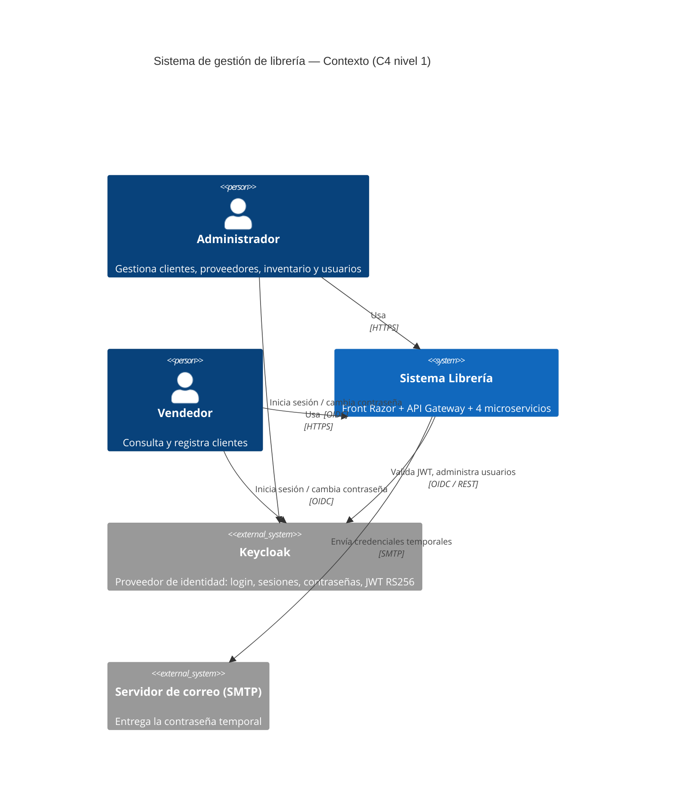

#### Nivel 2 — Contenedores

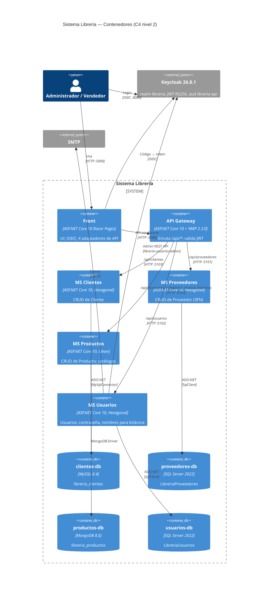

#### Nivel 3 — Componentes del MS Clientes (Hexagonal)

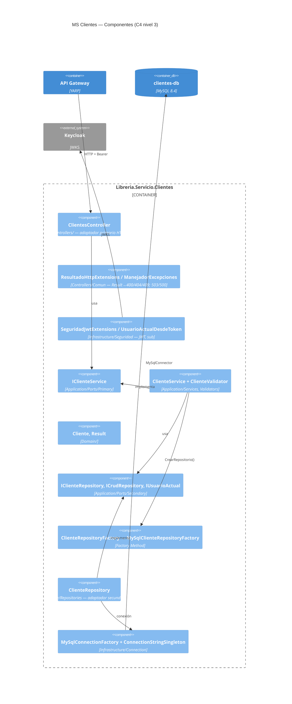

#### Nivel 3 — Componentes del MS Proveedores (Hexagonal)

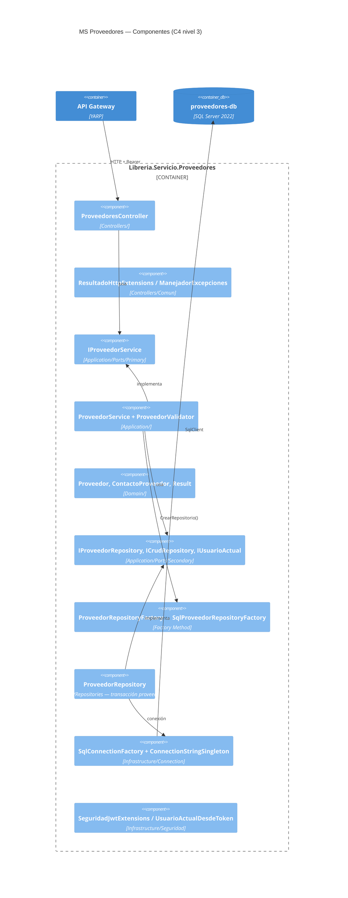

#### Nivel 3 — Componentes del MS Productos (Clean)

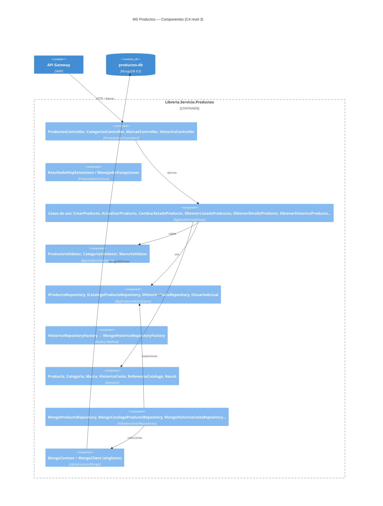

#### Nivel 3 — Componentes del MS Usuarios (Hexagonal)

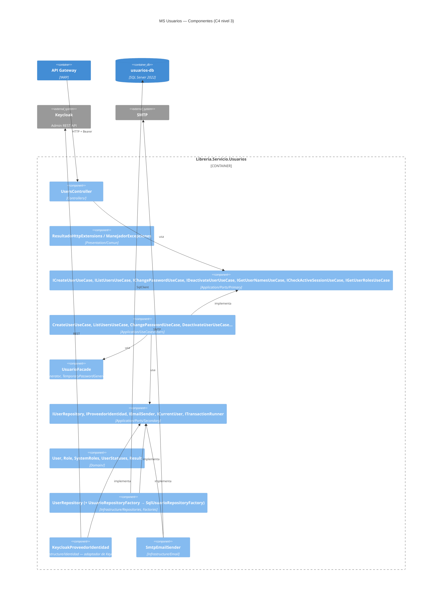

#### Vista combinada 1-2-3 (contexto → contenedores → componentes del Front)

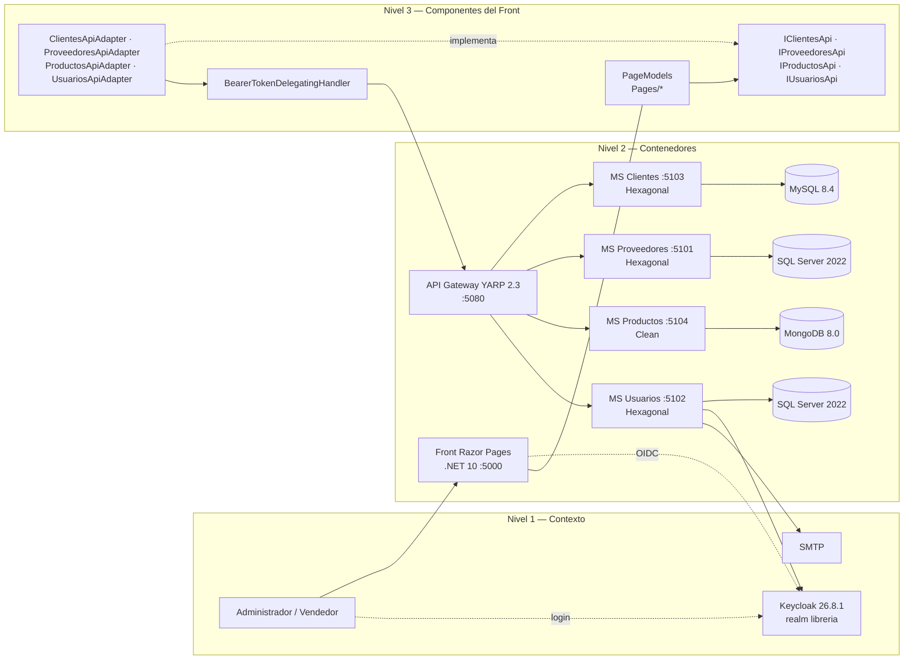

### 3.3 Diagramas de clases de los patrones

#### Result

Archivos: `src/Libreria.Servicio.{Clientes,Proveedores,Productos,Usuarios}/Domain/Result.cs`. Hay una copia por MS, sin biblioteca compartida.

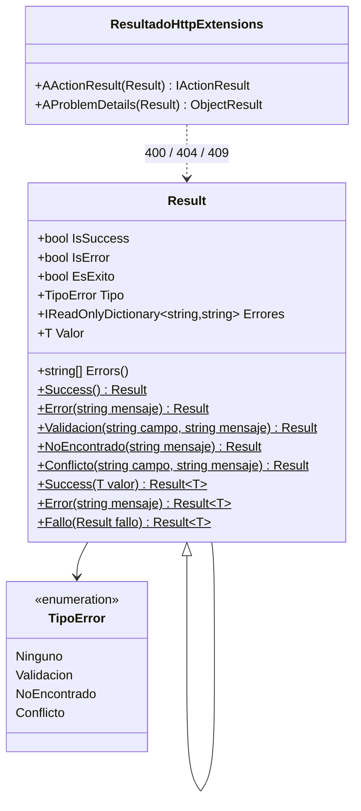

Cómo funciona:

- Las validaciones de negocio devuelven `Result` (por ejemplo, `ClienteValidator.ValidarAsync`) en lugar de lanzar excepciones.
- `Error(mensaje)` devuelve el mismo tipo, así que encadena con `Result<T>`.
- `ResultadoHttpExtensions` traduce el resultado a `ValidationProblemDetails` de forma uniforme.
- Lo inesperado (BD caída) sí es una excepción y lo atiende `ManejadorExcepciones` (503/500).

#### Adapter — un adaptador por API consumida desde el Front

Archivos:

- `src/Libreria.Client/Adapters/{Clientes,Proveedores,Productos,Usuarios}/`
- `src/Libreria.Client/Clients/Common/ApiClientBase.cs`, `BearerTokenDelegatingHandler.cs`, `ResultadoApiTraductor.cs`
- Registro: `Adapters/DependencyInjection/ApiGateway.cs`

```mermaid
classDiagram
    direction LR
    class IndexModel_Clientes["Pages/Clientes/IndexModel (cliente)"]
    class IClientesApi {
        <<interface>>
        +ObtenerClientesAsync(FiltroClientes)
        +RegistrarClienteAsync(ClienteInput)
        +ActualizarClienteAsync(Guid, ClienteInput)
        +CambiarEstadoClienteAsync(Guid, bool)
    }
    class IProveedoresApi { <<interface>> }
    class IProductosApi { <<interface>> }
    class IUsuariosApi { <<interface>> }
    class ApiClientBase {
        <<abstract>>
        #LeerAsync~T~(url)
        #EnviarPostAsync(url, cuerpo) ResultadoApi
        -EnsureSuccessAsync()
    }
    class ClientesApiAdapter
    class ProveedoresApiAdapter
    class ProductosApiAdapter
    class UsuariosApiAdapter
    class HttpClient["HttpClient «ApiGateway»"]
    class BearerTokenDelegatingHandler
    IndexModel_Clientes --> IClientesApi : depende solo de la interfaz
    ClientesApiAdapter ..|> IClientesApi
    ProveedoresApiAdapter ..|> IProveedoresApi
    ProductosApiAdapter ..|> IProductosApi
    UsuariosApiAdapter ..|> IUsuariosApi
    ClientesApiAdapter --|> ApiClientBase
    ProveedoresApiAdapter --|> ApiClientBase
    ProductosApiAdapter --|> ApiClientBase
    UsuariosApiAdapter --|> ApiClientBase
    ApiClientBase --> HttpClient
    HttpClient --> BearerTokenDelegatingHandler : Authorization: Bearer
```

Cómo funciona:

- Cada interfaz es el «destino» que la UI necesita.
- Cada adaptador «adapta» el API REST del gateway: arma la URL, envía el token y convierte JSON, `ProblemDetails` y códigos HTTP en DTOs y mensajes en español (`ResultadoApi`, `ServicioNoDisponibleException`).
- Las páginas no conocen `HttpClient` (DIP).

#### Factory Method

Archivos: `src/Libreria.Servicio.Clientes/Application/Factories/{CrudRepositoryFactory,ClienteRepositoryFactory}.cs` e `Infrastructure/Factories/MySqlClienteRepositoryFactory.cs`. Son análogos:

- Proveedores: `ProveedorRepositoryFactory` → `SqlProveedorRepositoryFactory`.
- Productos: `HistoricoRepositoryFactory` → `MongoHistoricoRepositoryFactory`, y `CrudRepositoryFactory<T>` → `MongoCategoriaRepositoryFactory`, `MongoMarcaRepositoryFactory`, `MongoProductoRepositoryFactory`.
- Usuarios: `UsuarioRepositoryFactory` → `SqlUsuarioRepositoryFactory`.

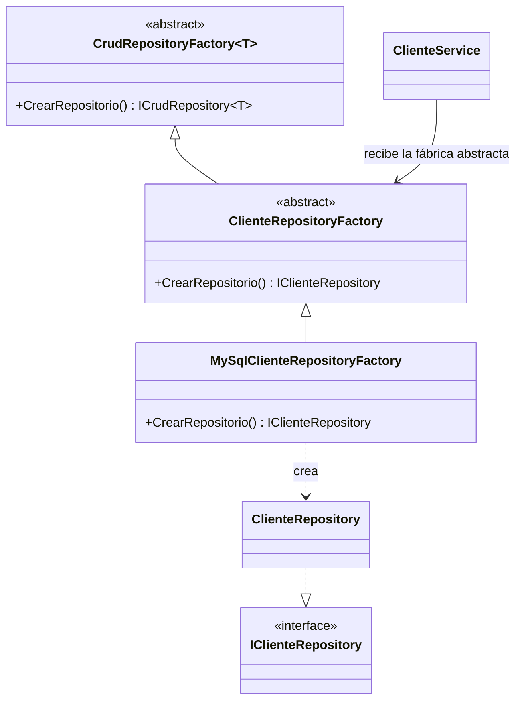

Cómo funciona: Application declara el creador abstracto y no sabe qué motor hay detrás. Infrastructure decide el producto concreto (MySQL, SQL Server o Mongo).

#### Facade

Archivo: `src/Libreria.Servicio.Usuarios/Application/Facades/UsuarioFacade.cs`.

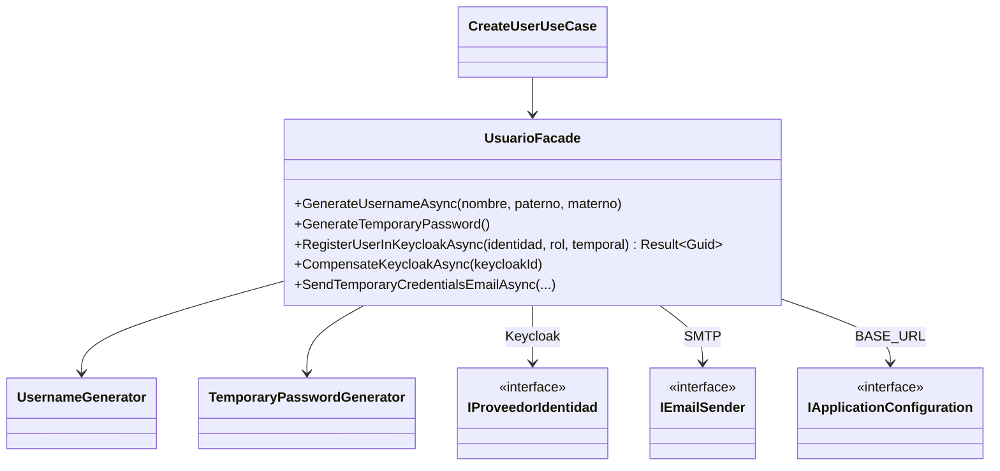

Cómo funciona: el caso de uso de alta ve una sola puerta para cuatro subsistemas (protocolo de nombre, contraseña segura, Keycloak con compensación `CompensateKeycloakAsync` si falla, y correo).

#### Singleton

Archivos:

- `src/Libreria.Servicio.{Clientes,Proveedores,Usuarios}/Infrastructure/Connection/ConnectionStringSingleton.cs`
- `src/Libreria.Servicio.Productos/Program.cs` (`AddSingleton<IMongoClient>`)

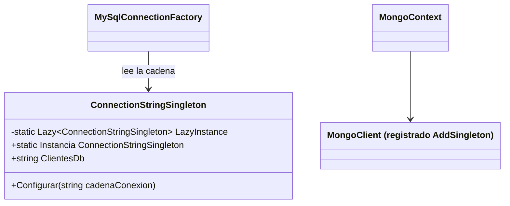

El diagrama usa los nombres de Clientes. En Usuarios la clase expone `Instance`, `Configure(...)` y `LibraryDb`, y la usa `SqlConnectionFactory`.

Cómo funciona: una sola instancia, perezosa y segura entre hilos (`LazyThreadSafetyMode.ExecutionAndPublication`), con la cadena de conexión configurada una vez al arrancar. Con `MongoClient`, el driver recomienda una sola instancia por proceso porque mantiene el pool de conexiones.

### 3.4 Estilos arquitectónicos: árboles y capturas

**MS Clientes (Hexagonal)** — `src/Libreria.Servicio.Clientes/`

```
Domain/                 Cliente.cs, Result.cs
Application/
  Ports/Primary/        IClienteService.cs
  Ports/Secondary/      IClienteRepository.cs, ICrudRepository.cs, IUsuarioActual.cs, ValorDuplicadoException.cs
  Services/             ClienteService.cs
  Validators/           ClienteValidator.cs
  Factories/            CrudRepositoryFactory.cs, ClienteRepositoryFactory.cs
  Models/Clientes/      ClienteInput.cs, ClienteDetalle.cs, FiltroClientes.cs
Infrastructure/
  Connection/           IDbConnectionFactory.cs, MySqlConnectionFactory.cs, ConnectionStringSingleton.cs
  Factories/            MySqlClienteRepositoryFactory.cs
  Repositories/         ClienteRepository.cs
  Seguridad/            SeguridadJwtExtensions.cs, SwaggerBearerExtensions.cs, UsuarioActualDesdeToken.cs
Controllers/            ClientesController.cs, Comun/(ManejadorExcepciones, ResultadoHttpExtensions), Dtos/
```

Capturas que demuestran la regla:

1. `Application/Ports/Secondary/IClienteRepository.cs` (puerto sin SQL).
2. `Infrastructure/Repositories/ClienteRepository.cs` (encabezado `: IClienteRepository` + `using MySqlConnector`).
3. `Controllers/ClientesController.cs` (constructor que recibe solo `IClienteService`).

**MS Proveedores (Hexagonal)** — igual estructura, con `Domain/Entities/{Proveedor,ContactoProveedor}.cs` y `Infrastructure/Connection/SqlConnectionFactory.cs`.

Capturas:

1. `Application/Ports/Primary/IProveedorService.cs`.
2. `Infrastructure/Repositories/ProveedorRepository.cs` (transacción proveedor + contacto).
3. `Application/Services/ProveedorService.cs` (recibe `ProveedorRepositoryFactory`).

**MS Usuarios (Hexagonal)** — `src/Libreria.Servicio.Usuarios/`

```
Domain/                 Entities/(User, Role), Constants/(SystemRoles, UserStatuses), Result.cs
Application/
  Ports/Primary/        7 interfaces de casos de uso
  Ports/Secondary/      IUserRepository, IProveedorIdentidad, IEmailSender, ICurrentUser, ITransactionRunner, IApplicationConfiguration
  UseCases/Users/       Create, List, ChangePassword, Deactivate, GetUserNames, GetUserRoles, CheckActiveSession
  Facades/              UsuarioFacade.cs
  Services/             UsernameGenerator.cs, TemporaryPasswordGenerator.cs
  Validation/           PasswordPolicyValidator.cs
  Factories/            UsuarioRepositoryFactory.cs
Infrastructure/         Repositories/UserRepository, Identidad/KeycloakProveedorIdentidad, Email/SmtpEmailSender,
                        Connection/, Factories/SqlUsuarioRepositoryFactory, Seguridad/, Transactions/, Configuration/
Controllers/            UsersController.cs
Presentation/Comun/     ManejadorExcepciones.cs, ResultadoHttpExtensions.cs
```

Capturas:

1. `Application/Ports/Secondary/IProveedorIdentidad.cs` (puerto).
2. `Infrastructure/Identidad/KeycloakProveedorIdentidad.cs` (adaptador hacia Keycloak).
3. `Infrastructure/Identidad/ProveedorIdentidadEnMemoria.cs`: segundo adaptador del mismo puerto (pruebas y Development). Es la mejor demostración de puertos y adaptadores.

**MS Productos (Clean)** — `src/Libreria.Servicio.Productos/`

```
Domain/            Entities/(Producto, Categoria, Marca, HistoricoCosto, ReferenciaCatalogo), Catalogs/, Result.cs
Application/       Abstractions/(IProductoRepository, ICatalogoProductoRepository, IHistoricoCostoRepository, ICrudRepository, IUsuarioActual)
                   UseCases/(Productos, Categorias, Marcas, Historico), Validators/, Models/, Factories/
Infrastructure/    Mongo/(MongoContext, MongoSerialization), Repositories/Mongo*, Factories/Mongo*, Seguridad/
Presentation/      Controllers/(Productos, Categorias, Marcas, Historico), Comun/
```

Capturas:

1. Los `using` de `Domain/Entities/Producto.cs` (sin MongoDB).
2. `Application/Abstractions/IProductoRepository.cs` (sin MongoDB).
3. `Infrastructure/Repositories/MongoProductoRepository.cs` (`using MongoDB.Driver` + `: IProductoRepository`).
4. `Presentation/Controllers/ProductosController.cs` (recibe casos de uso).

**Microservicios (estilo de sistema)** — capturas:

- `docker-compose.yml`: una BD por servicio.
- `yarp.g1.json`: rutas del gateway.
- Keycloak: realm `libreria` con sus clientes.

### 3.5 Bases de datos

#### Clientes — MySQL (`db/clientes/00_esquema.sql`)

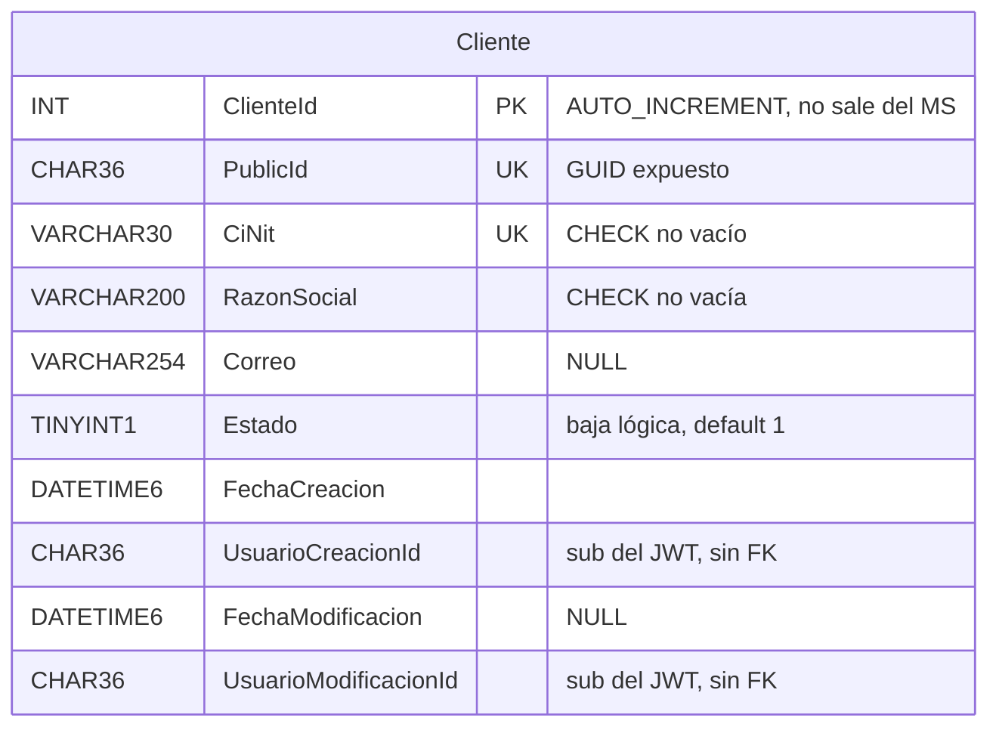

#### Proveedores — SQL Server, 3FN (`db/proveedores/00_esquema.sql`)

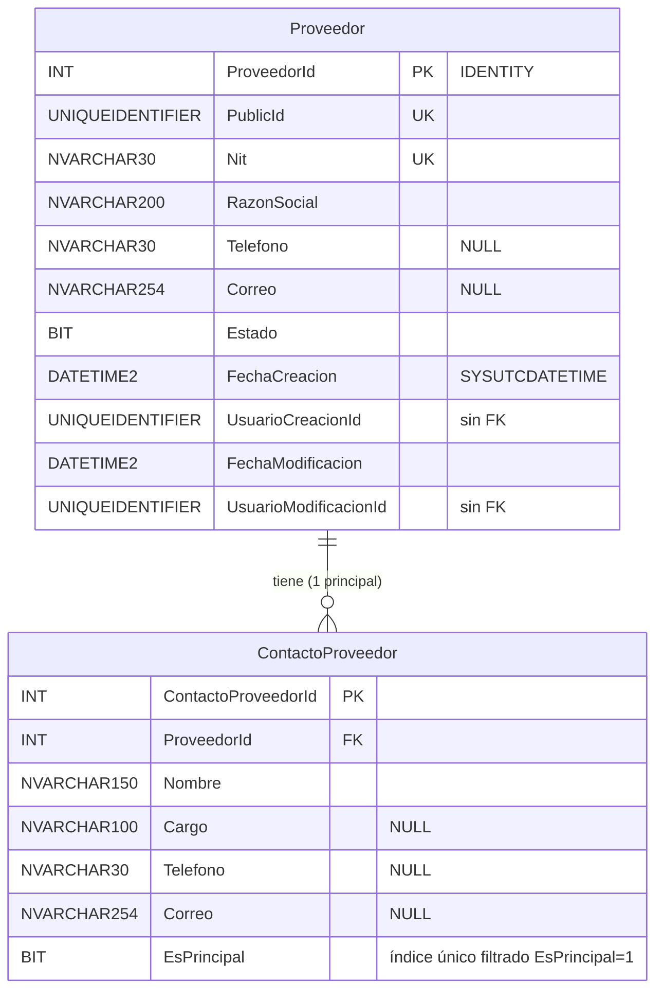

Justificación de la 3FN (para Cesar):

- **1FN:** valores atómicos; no hay listas de teléfonos ni de contactos en una columna.
- **2FN:** las claves son simples (`ProveedorId`, `ContactoProveedorId`), así que no hay dependencias parciales.
- **3FN:** los datos del contacto (nombre, cargo, teléfono, correo) dependen del contacto y no del proveedor. Por eso viven en `ContactoProveedor`, y no hay atributos no clave que dependan de otro atributo no clave.
- Restricciones:
  - `CK_ContactoProveedor_Medio`: teléfono o correo obligatorio.
  - `UQ_ContactoProveedor_Principal`: un solo contacto principal por proveedor.

#### Usuarios — SQL Server (`db/usuarios/00_esquema.sql`)

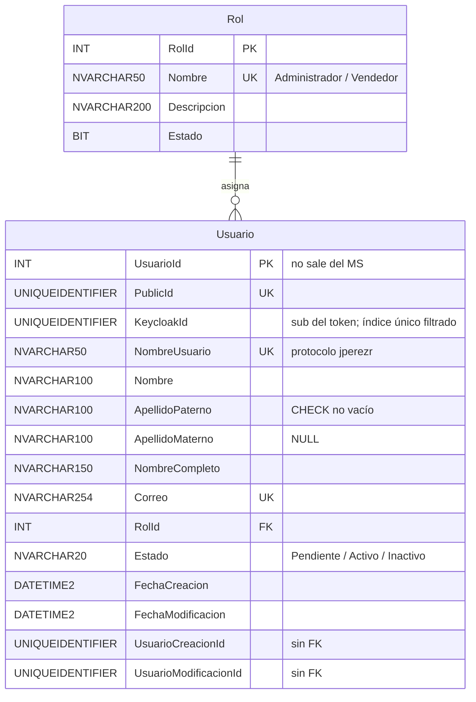

Sin columnas de contraseña: las credenciales viven solo en Keycloak.

#### Productos — MongoDB (`db/productos/00_esquema.js`, `50_datos_semilla.js`)

Colecciones `productos`, `categorias`, `marcas` y `contadores`. Documento real de `productos`:

```json
{
  "publicId": "d0000000-0000-0000-0000-000000000001",
  "nombre": "Cuaderno Espiral 100 hojas",
  "descripcionEspecifica": "Cuadriculado",
  "esPerecedero": false,
  "fechaVencimiento": null,
  "stock": 150,
  "precioVenta": "Decimal128(15.00)",
  "costoAdquisicionActual": "Decimal128(10.00)",
  "estado": true,
  "categoria": { "publicId": "ca000000-…-001", "nombre": "Material escolar" },
  "marca":     { "publicId": "b0000000-…-001", "nombre": "Faber-Castell" },
  "historicoCostos": [
    { "costoAdquisicion": "Decimal128(10.00)", "fechaVigencia": "ISODate", "motivo": "Registro inicial",
      "fechaVencimiento": null, "tipoCambioUsd": null, "usuarioCreacionId": "a0000000-…-001" }
  ],
  "fechaCreacion": "ISODate", "usuarioCreacionId": "a0000000-…-001",
  "fechaModificacion": null, "usuarioModificacionId": null
}
```

Otros documentos:

- `categorias`: `publicId`, `codigo` («CAT-001»), `nombre`, `descripcion`, `ubicacion`, `estado` y los 4 campos de auditoría.
- `marcas`: `publicId`, `nombre`, `descripcion`, `paisOrigen`, `sitioWeb`, `estado` y los 4 campos de auditoría.
- `contadores`: `{ _id: "categoria", valor: 3 }`, el secuencial del código de categoría.

**Embebidos:**

- `categoria` y `marca` (referencia + nombre desnormalizado) para listar sin joins.
- `historicoCostos[]`, que crece con cada cambio de costo y se actualiza de forma atómica en el mismo documento.

**Índices:**

| Colección | Índices |
|---|---|
| `productos` | `UQ_productos_publicId` (único), `UQ_productos_nombre` (único), `IX_productos_categoria` (`categoria.publicId`), `IX_productos_marca` (`marca.publicId`), `IX_productos_estado_nombre` |
| `categorias` | `UQ_categorias_publicId`, `UQ_categorias_nombre`, `UQ_categorias_codigo` |
| `marcas` | `UQ_marcas_publicId`, `UQ_marcas_nombre` |

Para el diagrama del documento se puede usar este `classDiagram`:

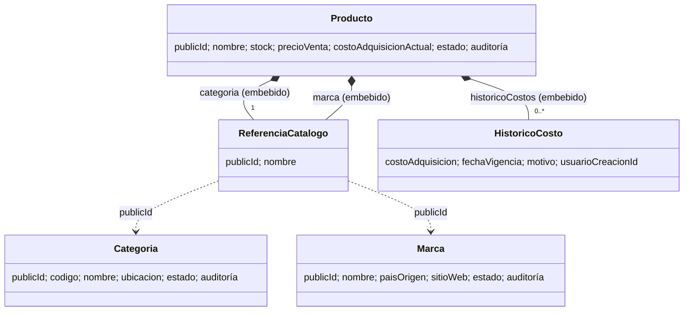

### 3.6 Lista de capturas a tomar

| # | Pantalla o archivo | Qué debe verse |
|---|---|---|
| 1 | `docker compose ps -a` | 4 BD y keycloak «healthy»; `*-db-init` y `keycloak-configurar` «Exited (0)» |
| 2 | Consola de `./run-all.ps1` | Tabla con los 6 proyectos en OK |
| 3 | Login de Keycloak | «Iniciar sesión en Librería» en español |
| 4 | Panel como Administrador y como Vendedor | Menús distintos por rol |
| 5 | Clientes: listado ordenado + modal de baja | Encabezado con ▲/▼; modal propio |
| 6 | Clientes: formulario con errores | Mensajes del Result por campo |
| 7 | Trazabilidad de un cliente | «Registrado por Vendedor Mostrador», «Última modificación por Administrador Sistema» y hora local |
| 8 | Consultas a las 3 BD del G1 | `UsuarioCreacionId` y `UsuarioModificacionId` con el `sub` |
| 9 | Proveedores: alta con contacto + diagrama 3FN | — |
| 10 | Productos: orden por precio + histórico de costos | — |
| 11 | Usuarios: listado (Activo y Pendiente) + Ctrl+U sin contraseñas | — |
| 12 | Registrar usuario: `jperezr` y `jperez2` + el `.eml` (con la **contraseña tapada**) | — |
| 13 | Keycloak: «Tiene que cambiar su contraseña para activar su cuenta.» | — |
| 14 | Cambiar contraseña: las 5 reglas en vivo con el botón deshabilitado + aviso tras el cierre de sesión | — |
| 15 | Swagger de un MS: 401 sin token y 200 con token | — |
| 16 | Matriz JWT | Tabla de la §6 de `rubrica_2026-11-20.md` |
| 17 | Servicio caído | Página «Servicio no disponible» con Proveedores detenido |
| 18 | Código de cada patrón | `Domain/Result.cs`, `IClientesApi` + `ClientesApiAdapter`, las 3 fábricas, `UsuarioFacade`, `ConnectionStringSingleton` |
| 19 | Capturas de estilos | Las de §3.4 |
| 20 | GitHub | Lista de PR mergeados a `develop` y gráfico de ramas |

---

## 4. Repositorio

- **URL:** https://github.com/Lackio-EL-14/Proyecto_Libreria_arqsoft
- **Ramas y propósito:**

| Rama | Propósito |
|---|---|
| `main` | Versión estable entregada. Recibe `develop` solo en US-137 (lunes 23) con el tag `v4-microservicios` |
| `develop` | Integración. Todo entra por PR |
| `feature/US-xx-nombre` | Una por historia (por ejemplo `feature/US-140`, `feature/US-124-126`, `feature/US-130-131-alta-usuarios-primer-ingreso`, `feature/microservicio-proveedores`) |
| `respaldo/ventas-entrega-final` | Conserva el MS Ventas fuera de este entregable (US-120) |
| `auditoria-microservicios` | Esta auditoría (24 commits `AUD: …`) |

- **Tags:** `v3-sba`, el estado SBA antes de la migración (monolito). Está planificado `v4-microservicios` para el cierre.
- **PR:** 74 PR mergeados a `develop` según el historial (`git log develop --oneline | grep "(#"`). Los del sprint de microservicios van del #71 (US-109) al #93 (US-130/131).
- **Commits por autor en `develop`** (`git shortlog -sn develop`, nombres tal como figuran en git):

| Autor | Commits |
|---|---:|
| Lackio-EL-14 | 29 |
| Cesar Cadiz | 24 |
| Josue Camacho | 15 |
| BigSmoke | 11 |
| MauricioGarron | 11 |
| Metzar | 8 |
| GabrielClarosGarcia | 7 |
| JMjuanma | 7 |
| Josue-Camacho | 2 |

  > A confirmar por el equipo: a qué integrante corresponde cada alias (Lackio-EL-14, BigSmoke, Metzar, JMjuanma). Sumar los alias de una misma persona (por ejemplo, «Josue Camacho» + «Josue-Camacho»).

- **Convenciones:**
  - Commits en español con la historia al inicio (`US-xx: <qué cambia>`; en esta auditoría, `AUD: <qué corrige> (US-xxx, <dueño>)`).
  - Rebase diario sobre `develop`.
  - Sin `push --force` sobre `develop`.
  - El PR lo aprueba el dueño de la carpeta (sección 7 del planning).
  - Contratos publicados en `docs/contratos/` antes de implementar (contract-first).

## 5. Conclusiones — insumos (las redacta el equipo)

**Dificultades encontradas en el historial:**

- **Cambio de alcance el 17/11:**
  - Ventas salió del entregable y se conservó en una rama.
  - El 2.º MS relacional pasó a ser Proveedores.
  - Quedó un solo CRUD por MS.
  - Keycloak reemplazó el JWT propio (se retiraron `Argon2PasswordHasher`, `LoginUseCase` y la emisión propia).
- **Migración de `Result` a Domain (US-139) en paralelo con el trabajo del Grupo 2:** durante unos días convivieron dos `Result` en Usuarios. La auditoría los unificó.
- **Del monolito a 4 BD:** ninguna FK entre servicios. La bitácora pasó a guardar el `sub` de Keycloak y a pedir los nombres al MS Usuarios.
- **Secretos:** en commits antiguos llegaron a subirse un `.env` y cadenas con contraseña. Después se pasó a `.env.example` y User Secrets.

**Dificultades encontradas en la auditoría:**

- **SQL Server no ejecuta los scripts al crear el volumen.** El arranque «desde cero» dejaba sin BD a Proveedores y Usuarios, y el README decía lo contrario.
- **Dos identificadores del usuario** (`PublicId` en la BD y `KeycloakId` = `sub`) se confundieron en un caso de uso. Los usuarios nuevos nunca pasaban a Activo y un Administrador nuevo recibía 403. La prueba usaba el mismo GUID para ambos y ocultaba el error.
- **El cambio de contraseña** no cerraba la sesión ni dejaba bitácora.
- **Las fechas UTC** se mostraban como hora local.
- **Ortografía y estilo:** mezcla de «tú» y «usted», y textos de Keycloak por defecto («Contraseña incorrecta: longitud mínima 8.»).
- **Pruebas desiguales:** Proveedores no tenía pruebas de CRUD; Usuarios tenía 109.

**Aprendizajes para discutir:**

- Microservicios: costo de la autonomía (copias de `Result` y de la seguridad en cada MS) frente al acoplamiento.
- Defensa en profundidad: validar el JWT en el gateway **y** en cada MS.
- Contract-first.
- Patrones: Adapter para aislar la UI del HTTP; Result para no usar excepciones como control de flujo; puertos y adaptadores (`ProveedorIdentidadEnMemoria` frente a `KeycloakProveedorIdentidad`) para probar sin infraestructura.

**Recomendaciones para la próxima entrega:**

- Contenerizar los 6 procesos (US-138).
- Reincorporar Ventas como 5.º MS con comunicación asíncrona.
- Retirar los endpoints de Usuarios con id entero.
- Traducir los duplicados de Mongo a 409.
- Partir las clases de más de 300 líneas.

## 6. Bibliografía (documentación oficial de lo que se usa)

- Microsoft. *ASP.NET Core documentation* (.NET 10): https://learn.microsoft.com/aspnet/core/
- Microsoft. *Razor Pages*: https://learn.microsoft.com/aspnet/core/razor-pages/
- Microsoft. *Configure JWT bearer authentication in ASP.NET Core*: https://learn.microsoft.com/aspnet/core/security/authentication/configure-jwt-bearer-authentication
- Microsoft. *OpenID Connect web authentication in ASP.NET Core*: https://learn.microsoft.com/aspnet/core/security/authentication/configure-oidc-web-authentication
- Microsoft. *Handle errors in ASP.NET Core APIs (ProblemDetails, IExceptionHandler)*: https://learn.microsoft.com/aspnet/core/fundamentals/error-handling-api
- Microsoft. *Make HTTP requests using IHttpClientFactory (DelegatingHandler)*: https://learn.microsoft.com/aspnet/core/fundamentals/http-requests
- Microsoft. *YARP — Yet Another Reverse Proxy*: https://learn.microsoft.com/aspnet/core/fundamentals/servers/yarp/yarp-overview y https://github.com/dotnet/yarp
- Microsoft. *Microsoft.Data.SqlClient / ADO.NET*: https://learn.microsoft.com/sql/connect/ado-net/introduction-microsoft-data-sqlclient-namespace
- Microsoft. *SQL Server en contenedores Linux (sqlcmd)*: https://learn.microsoft.com/sql/linux/quickstart-install-connect-docker
- Microsoft. *.NET microservices: Architecture for containerized .NET applications*: https://learn.microsoft.com/dotnet/architecture/microservices/
- Keycloak. *Server Administration Guide* (realms, clientes, políticas de contraseña, acciones requeridas, localización): https://www.keycloak.org/docs/latest/server_admin/
- Keycloak. *Admin REST API*: https://www.keycloak.org/docs-api/latest/rest-api/
- OpenID Foundation. *OpenID Connect Core 1.0*: https://openid.net/specs/openid-connect-core-1_0.html
- IETF. *RFC 7519 — JSON Web Token (JWT)*: https://datatracker.ietf.org/doc/html/rfc7519
- IETF. *RFC 7636 — PKCE*: https://datatracker.ietf.org/doc/html/rfc7636
- IETF. *RFC 9457 — Problem Details for HTTP APIs*: https://datatracker.ietf.org/doc/html/rfc9457
- MongoDB. *C# Driver documentation*: https://www.mongodb.com/docs/drivers/csharp/current/
- MongoDB. *Data Modeling — embedded data*: https://www.mongodb.com/docs/manual/data-modeling/
- MySqlConnector. *Documentation*: https://mysqlconnector.net/
- MySQL. *MySQL 8.4 Reference Manual*: https://dev.mysql.com/doc/refman/8.4/en/
- Docker. *Docker Compose documentation*: https://docs.docker.com/compose/
- Swashbuckle.AspNetCore: https://github.com/domaindrivendev/Swashbuckle.AspNetCore
- xUnit.net: https://xunit.net/
- Simon Brown. *The C4 model for visualising software architecture*: https://c4model.com/
- Mermaid. *C4 diagrams / class diagrams / ER diagrams*: https://mermaid.js.org/
- Alistair Cockburn. *Hexagonal Architecture (Ports and Adapters)*: https://alistair.cockburn.us/hexagonal-architecture/
- Robert C. Martin. *Clean Architecture: A Craftsman's Guide to Software Structure and Design*. Prentice Hall, 2017.
- E. Gamma, R. Helm, R. Johnson, J. Vlissides. *Design Patterns: Elements of Reusable Object-Oriented Software* (Adapter, Facade, Factory Method, Singleton). Addison-Wesley, 1994.
